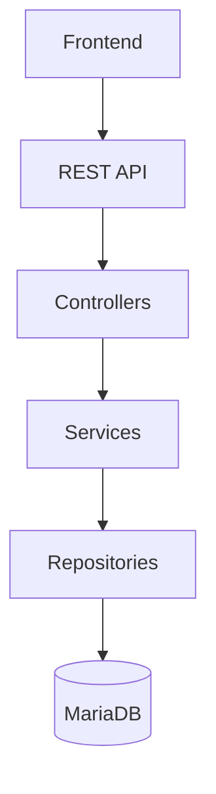
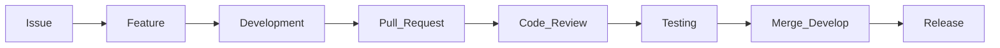

# 🏨 Tara Guest House Management System


---

## 📖 Overview

The **Tara Guest House Management System** is a modern full-stack web application designed to simplify and automate the daily operations of a guest house.

The system provides an integrated platform for guest registration, room management, booking management, payment processing, notifications, customer reviews, website content management, and administrative reporting.

The project follows a layered architecture and RESTful API design principles to ensure scalability, maintainability, and long-term extensibility.

---

# ✨ Features

- 🔐 User Authentication & Authorization
- 👤 User Management
- 🛏️ Room Management
- 📅 Booking Management
- 💳 Payment Management
- 🔔 Notification System
- ⭐ Review Management
- 📰 Content Management System (CMS)
- 📊 Administrative Dashboard
- 📈 Reporting & Analytics

---

# 🏗️ System Architecture



The project follows a layered architecture where each layer has a single responsibility.

---

# 🛠️ Technology Stack

| Layer | Technology |
|---------|------------|
| Frontend | Vue.js |
| Backend | Node.js |
| Framework | Express.js |
| Database | MariaDB |
| ORM | Sequelize |
| Authentication | JWT |
| Password Security | bcrypt |
| Styling | Tailwind CSS |
| API | RESTful API |
| Version Control | Git & GitHub |

---

# 📂 Repository Structure

```text
tara-guest-house/
│
├── backend/
│   ├── controllers/
│   ├── services/
│   ├── repositories/
│   ├── routes/
│   ├── models/
│   ├── middlewares/
│   ├── validators/
│   ├── config/
│   └── utils/
│
├── frontend/
│   ├── src/
│   ├── public/
│   └── assets/
│
├── database/
│
├── docs/
│   ├── 01_Project_Charter.md
│   ├── ...
│   └── 38_Development_Handbook.md
│
├── tests/
│
├── assets/
│
├── README.md
│
└── LICENSE
```

---

# 🚀 Getting Started

## Clone Repository

```bash
git clone https://github.com/your-username/tara-guest-house.git

cd tara-guest-house
```

---

## Backend Setup

```bash
cd backend

npm install

npm run dev
```

---

## Frontend Setup

```bash
cd frontend

npm install

npm run dev
```

---

## Environment Variables

Create a `.env` file inside the backend directory.

Example:

```env
DB_HOST=

DB_PORT=

DB_NAME=

DB_USER=

DB_PASSWORD=

JWT_SECRET=

EMAIL_HOST=

EMAIL_PORT=

EMAIL_USERNAME=

EMAIL_PASSWORD=
```

---

# 📚 Project Documentation

Complete project documentation is available inside the `docs/` directory.

| No | Document |
|----|----------|
| 01 | Project Charter |
| 02 | Software Requirements Specification |
| 03 | Stakeholder Analysis |
| 04 | Project Scope Statement |
| 05 | Functional Requirements |
| 06 | Non-Functional Requirements |
| 07 | Use Case Specifications |
| 08 | User Stories |
| 09 | Entity Relationship Diagram (ERD) |
| 10 | Database Design |
| 11 | Authentication Specification |
| 12 | User Management Specification |
| 13 | Room Management Specification |
| 14 | Booking Management Specification |
| 15 | Payment Management Specification |
| 16 | Notification System Specification |
| 17 | Review Management Specification |
| 18 | Content Management System Specification |
| 19 | Admin Dashboard Specification |
| ... | Additional Design & Planning Documents |
| 38 | Development Handbook |

---

# 👥 Development Team

| Role | Responsibility |
|------|----------------|
| Project Manager | Project Planning & Architecture |
| Backend Developer | API & Database Development |
| Frontend Developer | User Interface Development |
| QA Engineer | Testing & Quality Assurance |

---

# 🔄 Development Workflow



---

# 🌱 Git Branch Strategy

| Branch | Purpose |
|----------|----------|
| `main` | Production-ready code |
| `develop` | Integration branch |
| `feature/*` | Feature development |
| `hotfix/*` | Emergency fixes |

---

# 📌 Project Status

| Module | Status |
|----------|--------|
| Documentation | ✅ Complete |
| System Design | ✅ Complete |
| Database Design | ✅ Complete |
| Backend Development | 🚧 In Progress |
| Frontend Development | 🚧 In Progress |
| Testing | ⏳ Planned |
| Deployment | ⏳ Planned |

---

# 📋 Development Standards

This project follows:

- Layered Architecture
- Repository Pattern
- RESTful API Design
- JWT Authentication
- Role-Based Access Control (RBAC)
- Secure Password Hashing (bcrypt)
- Standardized API Responses
- Git Flow Workflow
- Code Review Process

Complete development guidelines are documented in:

**📄 38_Development_Handbook.md**

---

# 🧪 Testing

Testing activities include:

- Unit Testing
- Integration Testing
- API Testing
- UI Testing
- Regression Testing

---

# 🔮 Roadmap

### Sprint 1

- Authentication
- User Management
- Room Management

### Sprint 2

- Booking Management
- Payment Management
- Notification System

### Sprint 3

- Review System
- CMS
- Admin Dashboard

### Sprint 4

- Testing
- Bug Fixes
- Deployment
- Documentation Review

---

# 📄 License

This repository is currently maintained as a **Private Project**.

All rights reserved.

---

# 🙏 Acknowledgements

Special thanks to every contributor involved in the planning, design, development, testing, and documentation of the Tara Guest House Management System.

---

<p align="center">
Developed with ❤️ using Vue.js, Node.js, Express.js and MariaDB.
</p>

