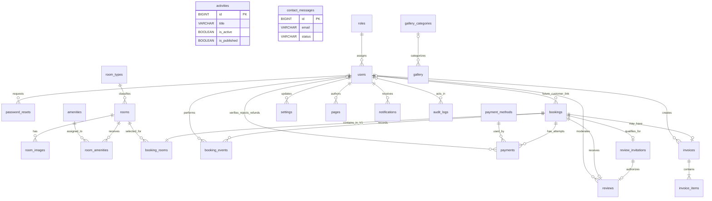

# Tara Guest House Entity Relationship Diagram

## Document Information

* Status: Synchronized — Review Required
* Source: `10_Database_Dictionary.md`
* Database authority: Executed migrations
* Scope: Version 1 entities and approved future-ready relationships

## 1. Relationship Diagram

`activities` and `contact_messages` are independent Version 1 content/inbox entities. They have no required foreign-key relationship in the approved dictionary. `gallery.gallery_category_id` is nullable.

## 2. Entity Inventory

| Area | Tables |
|---|---|
| Administrator identity | `roles`, `users`, `password_resets` |
| Rooms | `room_types`, `rooms`, `room_images`, `amenities`, `room_amenities` |
| Bookings | `bookings`, `booking_rooms`, `booking_events` |
| Payments and invoices | `payment_methods`, `payments`, `invoices`, `invoice_items` |
| Public content | `activities`, `gallery_categories`, `gallery`, `settings`, `pages` |
| Reviews | `review_invitations`, `reviews` |
| Contact and operations | `contact_messages`, `notifications`, `audit_logs` |

## 3. Identity Relationships

* One role may be assigned to many users.
* Each user has one role.
* Version 1 seeds and authenticates only the Administrator role.
* Guest is an unauthenticated actor, not a stored role.
* Password resets belong only to Administrator user records in Version 1.
* `bookings.user_id` is nullable and reserved for the future customer-account enhancement. Version 1 booking creation does not populate or require it.

## 4. Room Relationships

* A room type has many rooms; each room belongs to one room type.
* A room has zero or more images; each image belongs to one room.
* Rooms and amenities have a many-to-many relationship through `room_amenities`.
* `room_images.is_primary` identifies the primary public image. A separate thumbnail table is not part of Version 1.
* Room operational status and publication are fields on `rooms`; availability and occupancy are calculated from bookings rather than stored as relationships or room statuses.

## 5. Booking Relationships

* A Version 1 booking stores Guest name, email and phone snapshots and does not require a user/customer relationship.
* Each Version 1 booking has exactly one `booking_rooms` row. The junction table is retained so a later approved migration can support multiple rooms.
* A room may appear in many booking-room rows across non-conflicting date ranges.
* A booking has zero or more append-only `booking_events`.
* `booking_events.performed_by` is nullable for system/Guest-originated events and otherwise references an Administrator.
* Historical bookings are retained; deletion is not a normal booking workflow.

## 6. Payment and Invoice Relationships

* A booking has zero or more payment attempts.
* Each payment attempt belongs to one configured payment method.
* Administrator verification/rejection actors are recorded through nullable user foreign keys.
* A booking may have one stable invoice after eligibility is satisfied.
* An invoice contains one or more invoice items and preserves fixed-precision NPR snapshots.
* Payment transition evidence is retained through payment timestamps/actor fields and `audit_logs`; no undefined payment-event table is required by Version 1.

## 7. Content Relationships

* `activities` contains the complete approved Version 1 activity record; no activity-category or activity-image relationship is currently approved.
* A gallery category may contain many gallery items; an item may have no category.
* `settings` stores simple site-wide values.
* `pages` stores structured CMS content with `draft`, `published` and `archived` status.
* Settings do not substitute for structured pages.

## 8. Review Relationships

* A booking may receive one review only when `booking_status = checked_out`.
* A checked-out booking may have one secure, expiring, single-use `review_invitations` record.
* A review belongs to that invitation and the same booking.
* Review eligibility does not require a customer account, direct user relationship or direct room ownership.
* An Administrator may moderate many reviews; `reviews.moderated_by` is nullable until moderation.

## 9. Operational Relationships

* An Administrator user may receive many in-app `notifications`. Guests have no notification-centre relationship in Version 1.
* Guests receive transactional SMTP email using booking/contact data rather than a customer notification inbox.
* An Administrator may create many `audit_logs`; the actor is nullable for system events.
* `contact_messages` stores public submissions independently until an approved assignment/status policy adds further relationships.

## 10. Cardinality and Constraint Summary

| Relationship | Version 1 rule |
|---|---|
| Role to users | 1:N; only Administrator role active |
| User to bookings | Optional future link; not required/populated by V1 booking creation |
| Booking to booking rooms | Exactly 1:1 in Version 1 |
| Booking to events | 1:0..N |
| Booking to payments | 1:0..N |
| Booking to invoice | 1:0..1 |
| Invoice to items | 1:1..N |
| Booking to review invitation | 1:0..1 and only after `checked_out` |
| Booking/invitation to review | 1:0..1 |
| Room to images | 1:0..N |
| Room to amenities | M:N through `room_amenities` |
| Gallery category to gallery | 1:0..N; category link nullable |

## 11. Integrity Rules

1. Foreign keys and uniqueness constraints are defined by migrations.
2. Service validation and tests enforce exactly one room per Version 1 booking.
3. Availability creation/checking occurs transactionally using the approved overlap expression.
4. Booking, payment and review statuses use string-controlled PHP domain constants.
5. Financial values use fixed-precision NPR columns.
6. Reviews require a checked-out booking and unused invitation.
7. Historical booking events, payment evidence and audit records are retained.

This ERD must be updated whenever an approved migration changes the executable schema.
