# Development Handbook

**Project:** Tara Guest House Management System  
**Version:** 1.0  
**Document ID:** 38  
**Prepared By:** Project Manager & Technical Architect  
**Status:** Approved

---

# Document Information

| Field | Value |
|--------|-------|
| Document Name | Development Handbook |
| Document Number | 38 |
| Version | 1.0 |
| Status | Approved |
| Audience | Development Team |
| Last Updated | July 2026 |

---

# Table of Contents

1. Purpose
2. Project Architecture
3. Development Principles
4. Module Dependency Map
5. Architecture Decision Records (ADR)
6. Business Rules
7. Standard Status Values
8. API Development Standards
9. Backend Development Standards
10. Frontend Development Standards
11. Database Standards
12. Security Standards
13. Git Workflow
14. Coding Standards
15. Definition of Done
16. Team Responsibilities
17. Frequently Asked Questions
18. Future Improvements

---

# 1. Purpose

This handbook provides architectural decisions, development standards, coding conventions, and implementation guidelines for the Tara Guest House Management System.

The purpose of this document is to ensure that every developer follows the same architectural approach throughout the project lifecycle.

This document complements the existing documentation and resolves implementation ambiguities that may arise during development.

---

# 2. Project Architecture

The project follows a layered architecture.

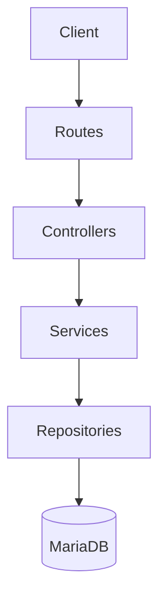

Each layer has a single responsibility.

| Layer | Responsibility |
|--------|---------------|
| Routes | Receive requests |
| Controllers | Request handling |
| Services | Business logic |
| Repositories | Database operations |
| Database | Persistent storage |

Architectural Rule:

No layer may bypass another layer.

For example,

Controllers must never communicate directly with the database.

---

# 3. Development Principles

The project follows these engineering principles.

- Separation of Concerns
- Single Responsibility Principle
- RESTful API Design
- Reusable Components
- Secure Authentication
- Maintainable Code
- Scalable Architecture

Every implementation must follow these principles.
---

# 4. Module Dependency Map

Understanding module dependencies is essential before implementing any feature. Every module within the Tara Guest House Management System interacts with one or more modules. These dependencies ensure that data integrity, business rules, and system consistency are maintained.

The implementation order should follow the dependency hierarchy shown below.

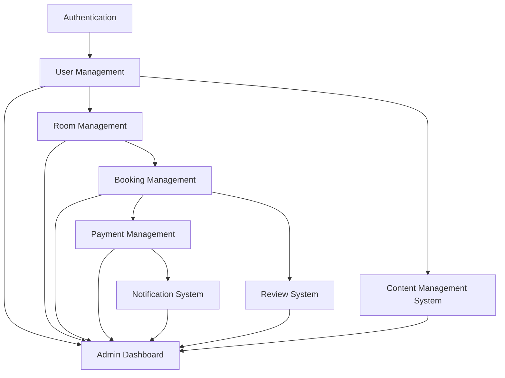

---

## Module Dependency Table

| Module | Depends On | Purpose |
|----------|------------|---------|
| Authentication | None | User login, registration and authorization |
| User Management | Authentication | User profile and account management |
| Room Management | User Management | Room inventory and availability |
| Booking Management | Authentication, Room Management | Guest reservations |
| Payment Management | Booking Management | Booking payment processing |
| Notification System | Booking Management, Payment Management | Email and in-app notifications |
| Review System | Booking Management | Guest reviews after completed stay |
| Content Management System | User Management | Website content administration |
| Admin Dashboard | All Modules | Reporting and monitoring |

---

## Dependency Rules

### Rule 1

Authentication must be completed before any protected module can be accessed.

---

### Rule 2

Bookings cannot be created without an authenticated user.

---

### Rule 3

Payments cannot exist without a booking.

---

### Rule 4

Notifications must only be generated by business events such as booking creation, payment verification, or password reset.

---

### Rule 5

Reviews require a completed booking.

Guests who have never completed a stay cannot submit reviews.

---

### Rule 6

Dashboard data is read-only.

The dashboard must never directly modify bookings, rooms, payments, reviews, or content.

---

### Rule 7

CMS content is independent of bookings but requires administrator authentication.

---

## Implementation Order

To minimize dependency issues, modules should be developed in the following order.

| Order | Module |
|---------|--------|
| 1 | Authentication |
| 2 | User Management |
| 3 | Room Management |
| 4 | Booking Management |
| 5 | Payment Management |
| 6 | Notification System |
| 7 | Review System |
| 8 | Content Management System |
| 9 | Admin Dashboard |

This order ensures that each module has its required dependencies available before implementation begins.

---

# 5. Architecture Decision Records (ADR)

Architecture Decision Records (ADR) document important technical decisions made during the design of the Tara Guest House Management System.

These decisions are mandatory implementation standards for all developers.

Every ADR includes:

- Decision
- Reason
- Affected Modules
- Implementation Notes

---

## ADR-001

### Title

Booking Automatically Creates a Payment Record

### Status

Accepted

### Decision

Whenever a booking is successfully created, the system shall automatically create a corresponding payment record with an initial status of **Pending**.

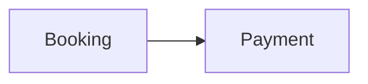

### Reason

- Prevent orphan bookings without payments.
- Maintain a one-to-one relationship between bookings and payments.
- Simplify payment tracking and reporting.
- Ensure every reservation enters the payment workflow.

### Affected Modules

- Booking Management
- Payment Management
- Notification System
- Admin Dashboard

### Implementation Notes

The Booking Service is responsible for creating the Payment record.

Frontend applications must never create Payment records directly.

---

## ADR-002

### Title

Payment Verification Confirms Booking

### Status

Accepted

### Decision

A booking shall remain in the **Pending** state until its associated payment has been successfully verified.

Only verified payments may transition a booking to the **Confirmed** state.

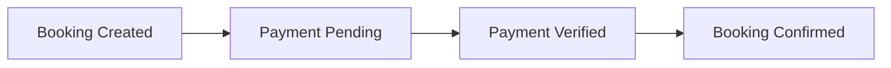

### Reason

- Prevent fraudulent reservations.
- Ensure financial accountability.
- Avoid reserving rooms without confirmed payments.
- Maintain consistency between booking and payment records.

### Affected Modules

- Booking Management
- Payment Management
- Notification System
- Admin Dashboard

### Implementation Notes

Payment verification shall be handled by the Payment Service.

The Booking Service must update the booking status only after receiving confirmation from the Payment Service.

Frontend applications must never change booking status directly.

---

## ADR-003

### Title

Booking Controls Room Availability

### Status

Accepted

### Decision

Room availability shall only be updated through the Booking Service.

No other module may directly modify room occupancy or reservation status.

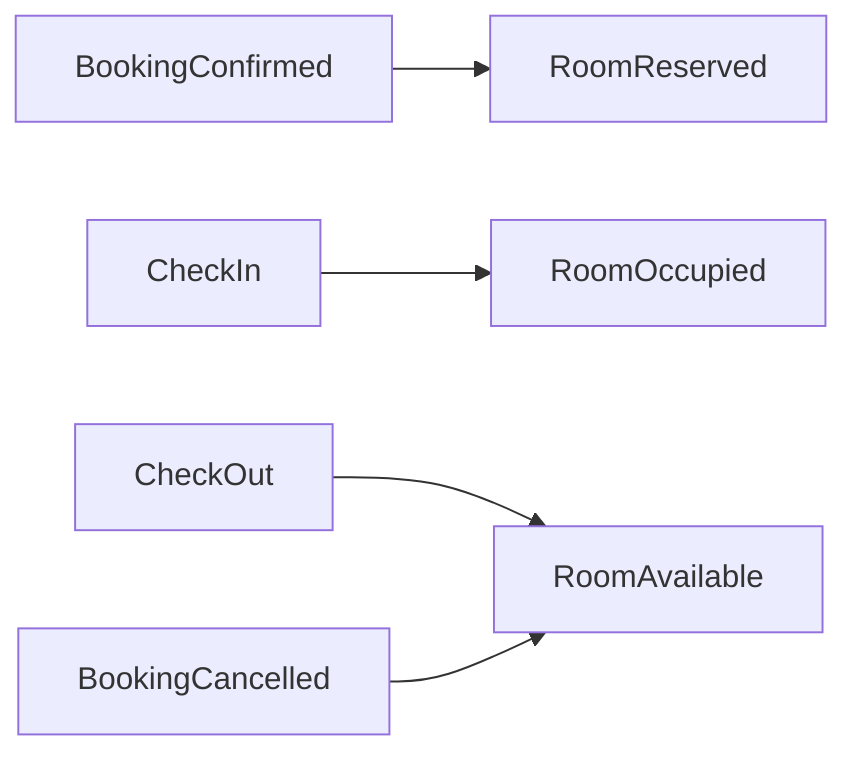

### Reason

- Prevent double bookings.
- Ensure room inventory remains accurate.
- Centralize room availability logic.
- Eliminate conflicting updates from different modules.

### Affected Modules

- Booking Management
- Room Management
- Admin Dashboard

### Implementation Notes

Room status updates must occur inside Booking Service transactions.

Frontend applications shall never update room status directly.

---

## ADR-004

### Title

Business Events Generate Notifications

### Status

Accepted

### Decision

Notifications shall only be generated automatically in response to business events.

Notifications must never be created manually by frontend applications.

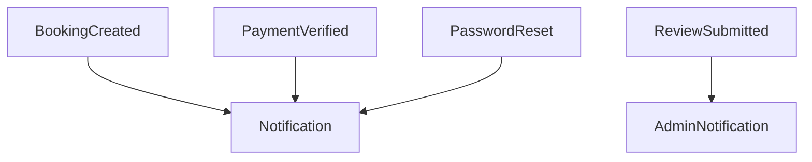

### Supported Events

- Booking Created
- Booking Confirmed
- Booking Cancelled
- Payment Verified
- Password Reset
- Review Submitted

### Reason

- Ensure consistent communication.
- Eliminate duplicate notifications.
- Centralize notification management.
- Improve maintainability.

### Affected Modules

- Notification System
- Booking Management
- Payment Management
- Authentication
- Review System

### Implementation Notes

The Notification Service is responsible for generating all notifications.

Future notification channels (SMS, WhatsApp, Push Notifications) should integrate with the Notification Service without affecting other modules.

---

## ADR-005

### Title

Reviews Require Completed Bookings

### Status

Accepted

### Decision

Guests may submit a review only after successfully completing their stay.

A booking must have a status of **Completed** before reviews become available.

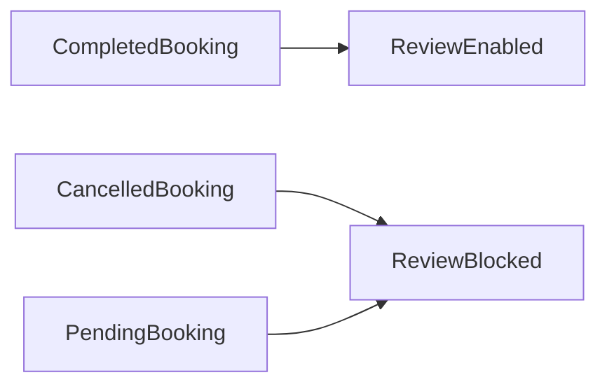

### Reason

- Ensure authentic guest feedback.
- Prevent fake or malicious reviews.
- Improve trustworthiness of ratings.
- Maintain business credibility.

### Affected Modules

- Review System
- Booking Management
- Dashboard

### Implementation Notes

Review eligibility shall be validated by the Review Service.

One booking may generate only one review.

Administrators retain the right to moderate or remove inappropriate reviews.

---

## ADR Summary

| ADR | Decision | Status |
|------|----------|--------|
| ADR-001 | Booking automatically creates Payment | Accepted |
| ADR-002 | Payment verification confirms Booking | Accepted |
| ADR-003 | Booking controls Room Availability | Accepted |
| ADR-004 | Business events generate Notifications | Accepted |
| ADR-005 | Reviews require completed Bookings | Accepted |

These Architecture Decision Records define the mandatory implementation rules for all development teams and shall be treated as project standards.

---

## ADR-006

### Title

CMS Content Publishing Workflow

### Status

Accepted

### Decision

All website content shall follow a controlled publishing workflow.

Pages must transition through predefined states before becoming publicly visible.

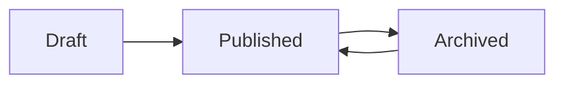

### Reason

- Prevent accidental publication.
- Allow content review before publishing.
- Maintain version control.
- Improve content management.

### Affected Modules

- Content Management System
- Admin Dashboard

### Implementation Notes

- Newly created pages default to **Draft**.
- Only users with **Administrator** role may publish or archive content.
- Archived pages remain stored in the database but are hidden from public users.
- Draft pages are never accessible through public routes.

---

## ADR-007

### Title

Dashboard is Read-Only

### Status

Accepted

### Decision

The Admin Dashboard shall be used exclusively for monitoring, reporting, and analytics.

It must never modify business data.

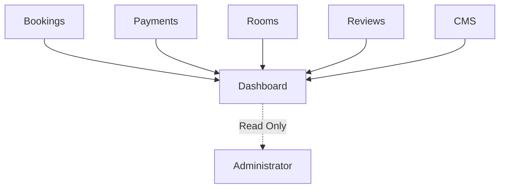

### Reason

- Prevent accidental data modification.
- Separate reporting from business operations.
- Improve maintainability.
- Reduce security risks.

### Affected Modules

- Admin Dashboard
- Booking Management
- Payment Management
- Room Management
- Review System
- CMS

### Implementation Notes

All dashboard widgets retrieve information through dedicated reporting services.

Dashboard components must never execute Create, Update, or Delete operations.

---

## ADR-008

### Title

Standard Status Enumerations

### Status

Accepted

### Decision

All modules shall use standardized status values.

Developers must never create custom status values unless approved by the Technical Architect.

### Standard Booking Status

| Status | Description |
|---------|-------------|
| Pending | Waiting for payment or confirmation |
| Confirmed | Reservation confirmed |
| Checked-In | Guest has arrived |
| Checked-Out | Guest has departed |
| Completed | Booking lifecycle finished |
| Cancelled | Reservation cancelled |

---

### Standard Room Status

| Status | Description |
|---------|-------------|
| Available | Ready for booking |
| Reserved | Reserved for future guest |
| Occupied | Guest currently staying |
| Maintenance | Temporarily unavailable |
| Inactive | Not available for booking |

---

### Standard Payment Status

| Status | Description |
|---------|-------------|
| Pending | Awaiting payment |
| Paid | Payment received |
| Verified | Payment verified |
| Failed | Payment unsuccessful |
| Refunded | Payment refunded |
| Cancelled | Payment cancelled |

---

### Standard Notification Status

| Status | Description |
|---------|-------------|
| Pending | Waiting to send |
| Sent | Successfully delivered |
| Failed | Delivery unsuccessful |
| Read | Viewed by recipient |

---

### Standard CMS Status

| Status | Description |
|---------|-------------|
| Draft | Under preparation |
| Published | Visible publicly |
| Archived | Hidden but retained |

### Reason

- Improve consistency.
- Simplify reporting.
- Reduce development errors.
- Standardize APIs.

---

## ADR-009

### Title

Repository Pattern Enforcement

### Status

Accepted

### Decision

All database operations shall be performed through Repository classes.

No Controller or Service may execute SQL directly.

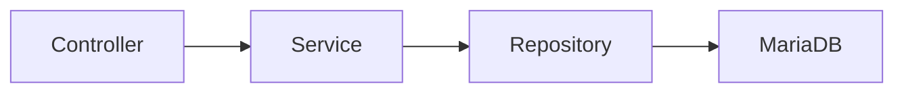

### Reason

- Separate business logic from data access.
- Improve maintainability.
- Simplify unit testing.
- Support future database migration.

### Affected Modules

All backend modules.

### Implementation Notes

Controllers:

- Receive requests.
- Validate input.
- Call Services.

Services:

- Execute business logic.
- Coordinate multiple repositories.

Repositories:

- Execute CRUD operations.
- Handle SQL queries.
- Manage database transactions.

---

## ADR-010

### Title

Standard API Response Format

### Status

Accepted

### Decision

Every REST API shall return a consistent JSON response structure.

### Success Response

```json
{
  "success": true,
  "message": "Operation completed successfully.",
  "data": {}
}
```

### Error Response

```json
{
  "success": false,
  "message": "Validation failed.",
  "errors": []
}
```

### Reason

- Simplify frontend integration.
- Standardize error handling.
- Improve API readability.
- Reduce duplicated parsing logic.

### Affected Modules

All REST API endpoints.

### Implementation Notes

Controllers should never return raw database objects.

Responses must be serialized through DTOs or response models before being sent to clients.

---

## ADR Summary

| ADR | Decision | Status |
|------|----------|--------|
| ADR-001 | Booking creates Payment | Accepted |
| ADR-002 | Payment verifies Booking | Accepted |
| ADR-003 | Booking manages Room Status | Accepted |
| ADR-004 | Business events generate Notifications | Accepted |
| ADR-005 | Reviews require completed Booking | Accepted |
| ADR-006 | CMS follows publishing workflow | Accepted |
| ADR-007 | Dashboard is read-only | Accepted |
| ADR-008 | Standard status enumerations | Accepted |
| ADR-009 | Repository pattern enforced | Accepted |
| ADR-010 | Standard API response format | Accepted |

These Architecture Decision Records are mandatory implementation standards and shall be followed throughout the development lifecycle.

---

---

# 6. Business Rules

Business Rules define the operational behavior of the Tara Guest House Management System.

These rules ensure consistency across all modules and must be enforced throughout the application.

Business Rules are mandatory and shall not be bypassed by frontend applications, backend services, or database operations.

---

# 6.1 Authentication Rules

### BR-001

All protected resources require an authenticated user.

Unauthenticated users may only access public pages such as:

- Home
- Rooms
- Gallery
- Contact
- About Us

---

### BR-002

Passwords must never be stored in plain text.

Passwords shall always be encrypted using bcrypt before storage.

---

### BR-003

JWT tokens shall be required for all authenticated API requests.

Expired tokens must return HTTP 401 Unauthorized.

---

# 6.2 User Management Rules

### BR-004

Each registered user shall have a unique email address.

Duplicate registrations are prohibited.

---

### BR-005

User roles determine system permissions.

Supported roles:

| Role | Description |
|------|-------------|
| Guest | Customer using the booking system |
| Receptionist | Daily booking operations |
| Administrator | Full system access |

Role changes may only be performed by Administrators.

---

# 6.3 Room Management Rules

### BR-006

Only rooms with status **Available** may be booked.

Rooms with the following status cannot be booked:

- Reserved
- Occupied
- Maintenance
- Inactive

---

### BR-007

Room availability shall always reflect the latest booking status.

Room status must never be updated manually by frontend applications.

---

### BR-008

Deleting rooms that have historical bookings is prohibited.

Inactive status should be used instead.

---

# 6.4 Booking Rules

### BR-009

Every booking shall belong to one registered guest.

Anonymous bookings are not permitted.

---

### BR-010

Creating a booking automatically creates:

- Payment Record
- Booking Timeline Entry
- Notification Event

This process shall occur within the Booking Service.

---

### BR-011

A booking cannot be confirmed until payment verification is complete.

Pending payment results in Pending Booking.

---

### BR-012

Booking cancellation shall automatically:

- Release the room
- Update booking status
- Update payment status (where applicable)
- Generate cancellation notification

---

### BR-013

Check-in is only permitted for Confirmed bookings.

---

### BR-014

Check-out automatically changes booking status to Completed.

---

# 6.5 Payment Rules

### BR-015

Each booking shall have one associated payment record.

---

### BR-016

Payment verification is performed only by authorized staff or approved payment integration.

---

### BR-017

Refunds may only be processed for eligible cancelled bookings.

---

### BR-018

Successful payments generate:

- Receipt
- Notification
- Dashboard statistics

---

# 6.6 Notification Rules

### BR-019

Notifications are generated only from business events.

Supported events include:

- Booking Created
- Booking Confirmed
- Booking Cancelled
- Payment Verified
- Password Reset
- Review Submitted

---

### BR-020

Users may only view their own notifications.

Administrators may view system-wide notification logs.

---

# 6.7 Review Rules

### BR-021

Reviews are permitted only after booking completion.

---

### BR-022

One completed booking may generate only one review.

---

### BR-023

Administrators may hide or remove reviews that violate community guidelines.

---

# 6.8 Content Management Rules

### BR-024

Only Administrators may create, publish, archive, or delete website content.

---

### BR-025

Draft content is never displayed publicly.

---

### BR-026

Archived content remains stored but is inaccessible through public pages.

---

# 6.9 Dashboard Rules

### BR-027

The dashboard aggregates information only.

It must never modify business records.

---

### BR-028

Dashboard statistics shall be generated from authoritative module data.

No duplicate calculations should exist.

---

# 6.10 Audit Rules

### BR-029

Critical business operations should be recorded in audit logs.

Examples include:

- Login
- Booking Creation
- Booking Cancellation
- Payment Verification
- User Role Changes
- Content Publishing

---

### BR-030

Audit records shall not be editable by standard users.

Only authorized administrators may access audit history.

---

# Business Rule Summary

| Category | Rule Count |
|----------|------------|
| Authentication | 3 |
| User Management | 2 |
| Room Management | 3 |
| Booking Management | 6 |
| Payment Management | 4 |
| Notification System | 2 |
| Review System | 3 |
| CMS | 3 |
| Dashboard | 2 |
| Audit & Logging | 2 |

**Total Business Rules:** 30

These business rules define the expected behavior of the system and are mandatory for all implementations.

---

# 7. Development Standards

Development Standards define the mandatory engineering practices that all team members must follow throughout the software development lifecycle.

These standards ensure consistency, maintainability, scalability, and code quality.

---

# 7.1 General Development Principles

All development activities shall follow these principles:

- Separation of Concerns (SoC)
- Single Responsibility Principle (SRP)
- DRY (Don't Repeat Yourself)
- KISS (Keep It Simple, Stupid)
- RESTful API Design
- Secure by Default
- Reusable Components
- Consistent Naming Conventions

---

# 7.2 Backend Architecture Standard

The backend follows a layered architecture.

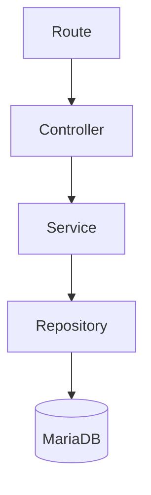

Every request must pass through every layer.

Direct access to lower layers is prohibited.

---

## Route Layer

Responsibilities

- Define API endpoints
- Apply middleware
- Forward requests to controllers

Routes must not contain:

- Business logic
- SQL queries
- Data validation

---

## Controller Layer

Responsibilities

- Receive HTTP requests
- Validate request format
- Call Service methods
- Return HTTP responses

Controllers must never:

- Execute SQL
- Access repositories directly
- Contain business logic

---

## Service Layer

Responsibilities

- Execute business logic
- Coordinate multiple repositories
- Handle transactions
- Enforce business rules

Services must never:

- Receive HTTP requests
- Return raw HTTP responses

---

## Repository Layer

Responsibilities

- CRUD operations
- SQL execution
- Database transactions
- Data retrieval

Repositories must never:

- Contain business rules
- Return HTTP responses

---

# 7.3 Frontend Development Standard

Frontend follows component-based architecture.

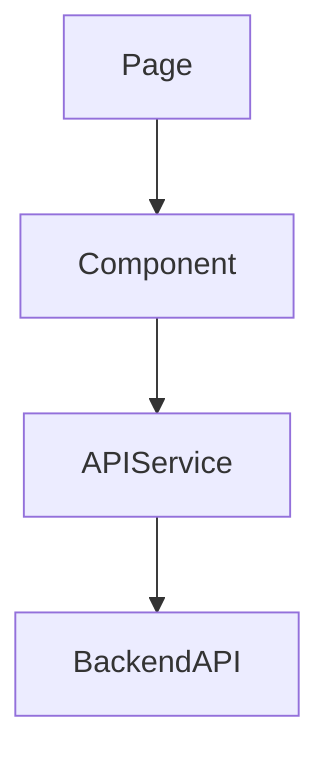

---

Pages

Responsibilities

- Route handling
- Page composition

Pages must never:

- Call database directly
- Contain duplicated business logic

---

Components

Responsibilities

- Reusable UI
- User interaction

Components should:

- Be reusable
- Remain independent
- Receive data through props

---

API Services

Responsibilities

- Send HTTP requests
- Receive responses
- Handle authentication tokens

API services should be the only place where HTTP requests are made.

---

# 7.4 Folder Structure Standard

Backend

```
backend/

controllers/

services/

repositories/

models/

routes/

middlewares/

validators/

config/

utils/
```

Frontend

```
frontend/

pages/

components/

layouts/

services/

composables/

assets/

router/

stores/
```

Folder structures shall remain consistent throughout development.

---

# 7.5 Naming Convention

Classes

Use PascalCase.

Example

BookingService

PaymentController

NotificationRepository

---

Variables

Use camelCase.

Example

bookingId

paymentStatus

guestName

---

Database Tables

Use snake_case.

Example

booking

payment

notification

room

review

---

API Endpoints

Use lowercase with hyphens where appropriate.

Examples

GET /api/bookings

POST /api/bookings

PUT /api/bookings/{id}

DELETE /api/bookings/{id}

---

# 7.6 Error Handling Standard

Errors must follow a consistent format.

```json
{
  "success": false,
  "message": "Validation failed.",
  "errors": [
    "Room is not available."
  ]
}
```

Every error response should include:

- Success flag
- Message
- Error details (if applicable)

Sensitive system information must never be exposed.

---

# 7.7 Logging Standard

The following events should be logged:

- User Login
- Failed Login
- Booking Creation
- Booking Cancellation
- Payment Verification
- Role Changes
- CMS Publishing
- Critical System Errors

Passwords, tokens, and sensitive information must never appear in logs.

---

# 7.8 Environment Configuration

Sensitive values shall be stored in environment variables.

Examples

```
DB_HOST=

DB_PORT=

DB_NAME=

DB_USER=

DB_PASSWORD=

JWT_SECRET=

EMAIL_HOST=

EMAIL_USER=
```

The `.env` file must never be committed to version control.

---

# 7.9 Code Review Standard

Every Pull Request shall be reviewed before merging.

Review Checklist

- Architecture followed
- Coding standards followed
- No duplicated code
- Proper error handling
- Validation implemented
- Security considered
- Tests completed
- Documentation updated (if applicable)

No developer may merge their own Pull Request into the `main` branch.

---

# 7.10 Development Checklist

Before marking a task as complete, developers must verify:

- Feature implemented
- Business rules followed
- Coding standards followed
- API tested
- No linting errors
- No build errors
- Pull Request created
- Code reviewed
- Documentation updated (if required)

---

# End of Development Standards

These standards are mandatory and apply to every contributor working on the Tara Guest House Management System.

---

---

# 8. Git Workflow & Development Process

This section defines the official Git workflow, branching strategy, commit conventions, pull request process, and release management standards for the Tara Guest House Management System.

All contributors must follow these guidelines.

---

# 8.1 Branching Strategy

The project follows a simplified Git Flow model.

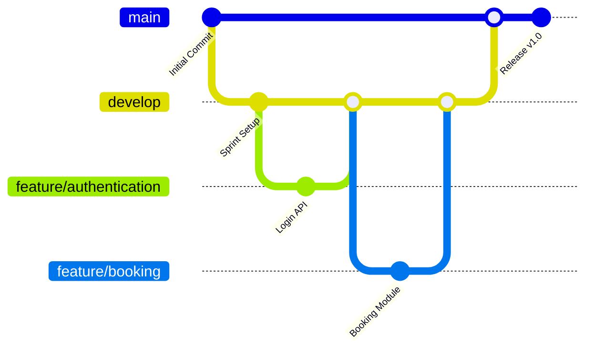

---

## Branch Responsibilities

| Branch | Purpose |
|----------|----------|
| main | Stable production-ready code |
| develop | Integration branch |
| feature/* | New feature development |
| hotfix/* | Emergency production fixes |
| release/* | Release preparation (optional) |

---

## Rules

- Never push directly to **main**.
- Development begins from **develop**.
- Every feature uses its own feature branch.
- Merge feature branches only after successful review.
- Production releases originate from **main**.

---

# 8.2 Feature Branch Naming

Feature branches shall follow:

```
feature/module-name
```

Examples

```
feature/authentication

feature/booking

feature/payment

feature/dashboard

feature/cms
```

Bug fixes

```
fix/login-validation

fix/payment-status
```

Hotfixes

```
hotfix/security-patch
```

---

# 8.3 Commit Message Convention

Commit messages should be clear, concise, and meaningful.

Format

```
type(scope): description
```

Examples

```
feat(auth): implement JWT login

feat(booking): create booking service

fix(payment): resolve duplicate payment issue

docs(api): update booking endpoints

style(frontend): improve dashboard layout

test(review): add review service tests

refactor(room): simplify availability logic
```

---

## Commit Types

| Type | Purpose |
|------|----------|
| feat | New feature |
| fix | Bug fix |
| docs | Documentation |
| style | Formatting/UI |
| refactor | Internal improvement |
| test | Testing |
| chore | Maintenance |

---

# 8.4 Pull Request Process

Every completed feature shall be submitted as a Pull Request.

Workflow

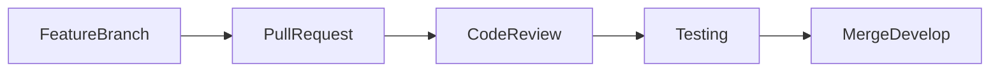

---

## Pull Request Checklist

Before requesting review:

- Code compiles successfully.
- No linting errors.
- Tests completed.
- Business rules implemented.
- Documentation updated (if required).
- No merge conflicts.
- Meaningful commit history.

---

## Reviewer Checklist

The reviewer should verify:

- Architecture compliance.
- Code readability.
- Security considerations.
- Business rule compliance.
- API consistency.
- Error handling.
- Test coverage.

---

# 8.5 Merge Rules

Feature Branch

↓

Develop

↓

Sprint Testing

↓

Main

Rules

- Feature branches merge only into **develop**.
- **develop** merges into **main** after Sprint validation.
- Direct merges to **main** are prohibited.

---

# 8.6 Release Versioning

The project follows Semantic Versioning.

Format

```
MAJOR.MINOR.PATCH
```

Examples

| Version | Description |
|----------|-------------|
| 1.0.0 | Initial Release |
| 1.1.0 | New Features |
| 1.1.1 | Bug Fix |
| 2.0.0 | Major Upgrade |

---

# 8.7 Sprint Workflow

Development progresses through short iterative sprints.

```mermaid
flowchart LR

Planning

-->

Development

-->

Code Review

-->

Testing

-->

Sprint Review

-->

Release
```

Every sprint concludes with:

- Feature completion.
- QA verification.
- Documentation updates.
- Sprint retrospective.

---

# 8.8 Code Ownership

| Area | Primary Owner | Reviewer |
|------|----------------|-----------|
| Authentication | Backend Developer | Project Manager |
| User Management | Backend Developer | Project Manager |
| Room Management | Backend Developer | Project Manager |
| Booking Management | Backend Developer | Project Manager |
| Payment Management | Backend Developer | Project Manager |
| Notification System | Backend Developer | Project Manager |
| Review System | Backend Developer | Project Manager |
| CMS | Frontend + Backend | Project Manager |
| Dashboard | Frontend Developer | Project Manager |
| Testing | QA Engineer | Project Manager |
| Documentation | Project Manager | Team |

---

# 8.9 Branch Protection Rules

The following rules should be configured for the **main** branch.

- Require Pull Request before merge.
- Require at least one approval.
- Prevent force pushes.
- Prevent branch deletion.
- Require all status checks to pass.

---

# 8.10 Development Lifecycle

Every feature shall follow the same lifecycle.

```mermaid
flowchart TD

Issue

-->

Feature Branch

-->

Development

-->

Local Testing

-->

Pull Request

-->

Review

-->

QA Testing

-->

Merge to Develop

-->

Sprint Release

-->

Main
```

This workflow ensures that every feature is reviewed, tested, and documented before reaching production.

---

---

# 9. Security Standards

Security is a fundamental requirement of the Tara Guest House Management System.

All developers shall follow these security standards during implementation.

---

## 9.1 Authentication Security

### Rules

- Passwords must be hashed using bcrypt.
- Plain text passwords shall never be stored.
- JWT tokens must be generated after successful authentication.
- Expired tokens shall return HTTP 401 Unauthorized.
- Password reset tokens must have an expiration time.
- User sessions must be invalidated after logout.

---

## 9.2 Authorization

Access control shall be enforced using Role-Based Access Control (RBAC).

| Role | Access Level |
|--------|-------------|
| Guest | Booking, Profile, Reviews |
| Receptionist | Booking Operations |
| Administrator | Full System Access |

Every protected endpoint shall verify user authorization before execution.

---

## 9.3 Input Validation

Every request must be validated.

Examples include:

- Required fields
- Email format
- Phone number format
- Numeric ranges
- Date validation
- Maximum character length

Validation must occur before business logic execution.

---

## 9.4 Database Security

Developers shall:

- Use parameterized queries.
- Never concatenate SQL strings.
- Enforce foreign key constraints.
- Use transactions for critical operations.
- Restrict direct database access.

---

## 9.5 Environment Variables

Sensitive configuration values shall be stored in environment variables.

Examples

```

DB_HOST=

DB_PORT=

DB_NAME=

DB_USER=

DB_PASSWORD=

JWT_SECRET=

SMTP_USERNAME=

SMTP_PASSWORD=

```

The `.env` file shall never be committed to version control.

---

## 9.6 API Security

Protected endpoints require:

- JWT Authentication
- Authorization
- Input Validation

Future Improvements

- Rate Limiting
- API Gateway
- Refresh Tokens
- Multi-Factor Authentication

---

# 10. Coding Standards

Consistent coding standards improve readability, maintainability, and collaboration.

---

## 10.1 Naming Convention

### Classes

Use PascalCase.

Example

```

BookingService

PaymentController

NotificationRepository

```

---

### Variables

Use camelCase.

Example

```

bookingId

paymentStatus

roomNumber

guestEmail

```

---

### Constants

Use UPPER_SNAKE_CASE.

Example

```

MAX_ROOM_CAPACITY

JWT_EXPIRATION

DEFAULT_PAGE_SIZE

```

---

## 10.2 File Naming

Controllers

```

BookingController.js

PaymentController.js

```

Services

```

BookingService.js

ReviewService.js

```

Repositories

```

BookingRepository.js

RoomRepository.js

```

---

## 10.3 Method Naming

Methods should use descriptive verbs.

Examples

```

createBooking()

cancelBooking()

verifyPayment()

sendNotification()

publishPage()

```

Avoid generic names such as:

```

process()

execute()

run()

```

---

## 10.4 Comments

Write comments only when necessary.

Prefer self-explanatory code.

Example

```javascript
// Calculate total booking amount including taxes
```

Avoid commenting obvious statements.

---

## 10.5 Code Quality

Developers should:

- Avoid duplicated code.
- Keep methods short.
- Separate business logic.
- Remove unused code.
- Use meaningful variable names.

---

# 11. Testing Standards

Every implemented feature shall be tested before merging.

---

## Required Testing

| Test Type | Required |
|------------|-----------|
| Unit Testing | Yes |
| API Testing | Yes |
| Integration Testing | Yes |
| UI Testing | Yes |
| Regression Testing | Yes |

---

## Testing Workflow

```mermaid
flowchart LR

Development

-->

Unit Testing

-->

Integration Testing

-->

QA Testing

-->

Approved
```

---

## Bug Severity

| Severity | Description |
|-----------|-------------|
| Critical | System unusable |
| High | Major functionality affected |
| Medium | Partial functionality affected |
| Low | Minor issue or UI inconsistency |

---

## Bug Lifecycle

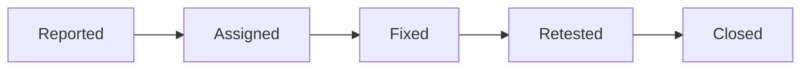

---

# 12. Definition of Done

A task is considered complete only when all criteria below are satisfied.

Development

☑ Feature implemented

☑ Business rules followed

☑ Coding standards followed

Testing

☑ Unit tests passed

☑ API tests passed

☑ QA approved

Documentation

☑ API documented

☑ Architecture unchanged or updated

☑ Relevant documentation updated

Repository

☑ Pull Request created

☑ Code reviewed

☑ Successfully merged into develop

Only after satisfying every criterion may a feature be marked as complete.

---

# 13. Developer Frequently Asked Questions

## Q1

Can Controllers access the database?

No.

Controllers communicate only with Services.

---

## Q2

Can Frontend update Room Status?

No.

Room Status is controlled exclusively by Booking Management.

---

## Q3

Can Payment exist without Booking?

No.

Every Payment belongs to exactly one Booking.

---

## Q4

Can Reviews be submitted before checkout?

No.

Only Completed Bookings may submit Reviews.

---

## Q5

Can Dashboard modify data?

No.

Dashboard is strictly read-only.

---

## Q6

Where should Business Logic be implemented?

Business Logic belongs exclusively inside the Service layer.

---

## Q7

Can Developers push directly to main?

No.

Development must follow the defined Git workflow.

---

# 14. Common Mistakes

Avoid the following implementation mistakes.

❌ Executing SQL inside Controllers

✔ SQL belongs inside Repositories

---

❌ Business Logic inside Frontend

✔ Business Logic belongs inside Services

---

❌ Hardcoded Credentials

✔ Store secrets inside .env

---

❌ Updating Room Availability manually

✔ Update through Booking Service

---

❌ Returning raw database objects

✔ Return standardized API responses

---

❌ Duplicating validation

✔ Centralize validation logic

---
---

# Appendix A – End-to-End System Workflow

This appendix illustrates the complete business workflow of the Tara Guest House Management System.

The workflow demonstrates how individual modules interact throughout the customer journey.

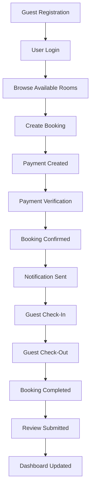

---

## Workflow Description

| Step | Description |
|--------|-------------|
| Registration | Guest creates account |
| Login | User authentication |
| Browse Rooms | View available rooms |
| Booking | Reservation created |
| Payment | Payment record generated |
| Verification | Payment approved |
| Confirmation | Booking confirmed |
| Notification | Confirmation sent |
| Check-In | Guest arrives |
| Check-Out | Guest departs |
| Completion | Booking completed |
| Review | Guest submits feedback |
| Dashboard | Reports updated |

---

# Appendix B – Module Interaction Matrix

The following matrix summarizes how each module interacts with the others.

| Module | Reads | Writes | Depends On |
|----------|--------|---------|------------|
| Authentication | Users | Sessions | None |
| User Management | Users | Users | Authentication |
| Room Management | Rooms | Rooms | Authentication |
| Booking Management | Users, Rooms | Bookings | Authentication, Rooms |
| Payment Management | Bookings | Payments | Booking |
| Notification System | Booking, Payment | Notifications | Booking, Payment |
| Review System | Booking | Reviews | Booking |
| CMS | Content | Content | Authentication |
| Dashboard | All Modules | None | All Modules |

---

# Appendix C – Standard HTTP Status Codes

The REST API shall use standard HTTP response codes.

| Code | Meaning |
|------|----------|
| 200 | OK |
| 201 | Created |
| 204 | No Content |
| 400 | Bad Request |
| 401 | Unauthorized |
| 403 | Forbidden |
| 404 | Not Found |
| 409 | Conflict |
| 422 | Validation Failed |
| 500 | Internal Server Error |

Developers shall not invent custom HTTP status codes.

---

# Appendix D – Glossary

| Term | Definition |
|------|------------|
| API | Application Programming Interface |
| ADR | Architecture Decision Record |
| CRUD | Create, Read, Update, Delete |
| DTO | Data Transfer Object |
| JWT | JSON Web Token |
| RBAC | Role-Based Access Control |
| REST | Representational State Transfer |
| Repository | Data access layer |
| Service | Business logic layer |
| Controller | HTTP request handler |
| Middleware | Request processing component |
| Entity | Database object |
| ORM | Object Relational Mapping |

---

# Appendix E – Revision History

| Version | Date | Description | Author |
|----------|------|-------------|--------|
| 1.0 | July 2026 | Initial Development Handbook | Project Manager |

Future revisions shall be recorded in this table.

---

# References

The Development Handbook should be used together with the following project documentation.

- Project Charter
- Software Requirements Specification (SRS)
- Functional Requirements
- Non-Functional Requirements
- Use Case Specifications
- User Stories
- Database Design
- Entity Relationship Diagram (ERD)
- API Specification
- Backend Architecture
- Frontend Architecture
- Authentication Specification
- Booking Management Specification
- Payment Management Specification
- Notification System Specification
- Review Management Specification
- Content Management Specification
- Admin Dashboard Specification
- Requirements Traceability Matrix
- Architecture Review Report
- Sprint 1 Readiness Report

---

# Document Approval

| Role | Responsibility | Status |
|------|----------------|--------|
| Project Manager | Architecture Approval | Approved |
| Technical Architect | Development Standards | Approved |
| Backend Lead | Backend Review | Pending |
| Frontend Lead | Frontend Review | Pending |
| QA Lead | Testing Review | Pending |

---

# Final Statement

The **Development Handbook** establishes the official engineering standards, architectural decisions, business rules, and development practices for the Tara Guest House Management System.

All team members are expected to follow this handbook throughout the project lifecycle.

Any deviation from these standards shall be reviewed and approved by the Project Manager and Technical Architect before implementation.

---

**Document Status:** Approved for Development

**Version:** 1.0

**End of Document**
